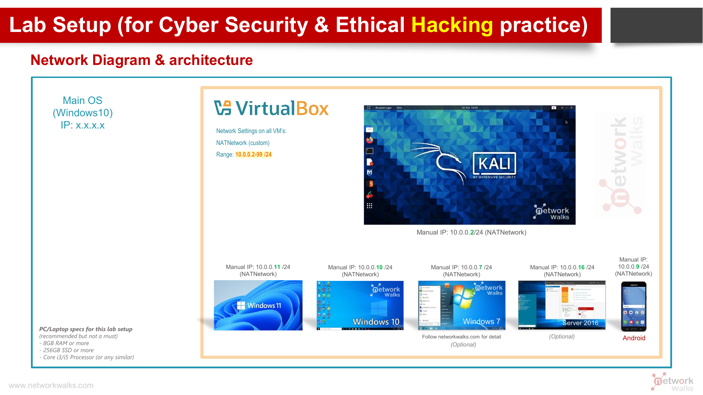
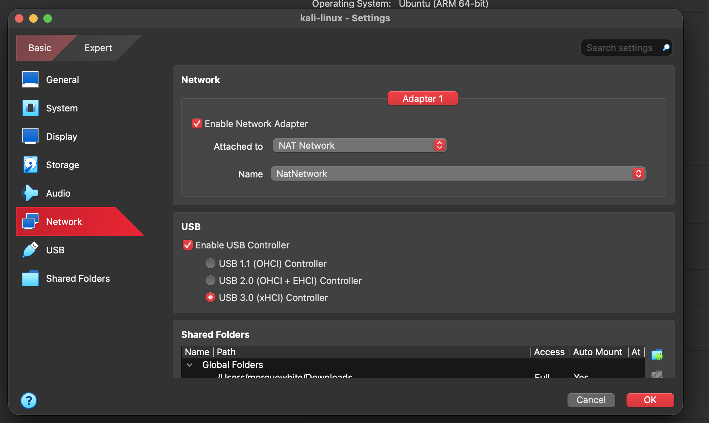
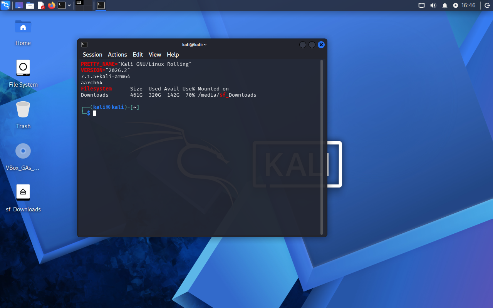
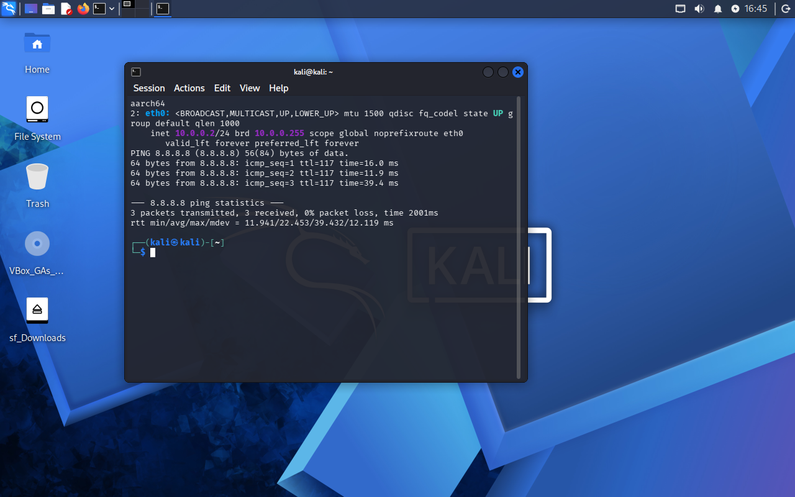
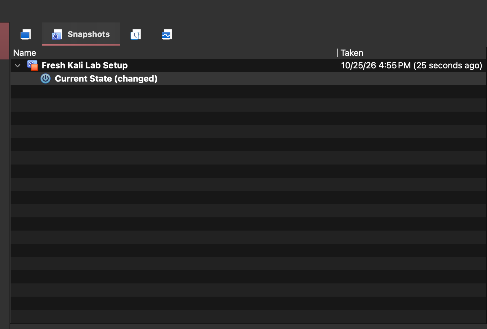
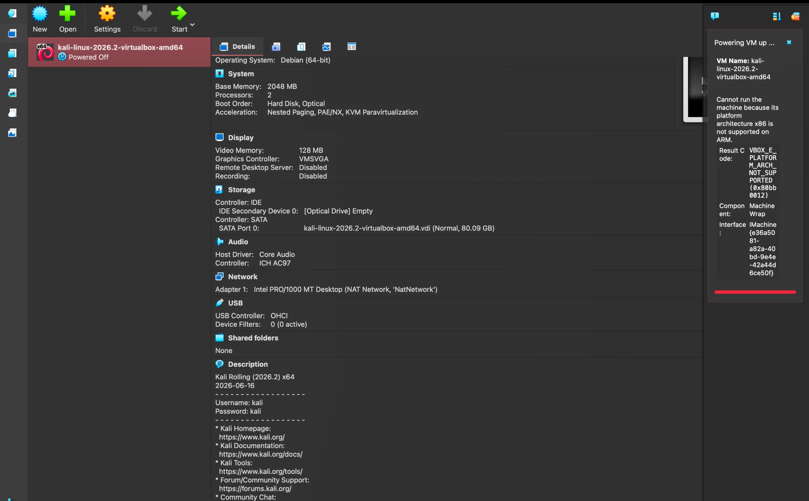

# 🔐 Cybersecurity Lab Environment Setup

Week 1 · Project Module 1 · NetworkWalks Cybersecurity Internship

## 📌 Project Overview

This project builds an isolated virtual lab for cybersecurity and ethical hacking practice. A Kali Linux attacker machine runs in VirtualBox on a private virtual network (`10.0.0.0/24`). More machines can be added later as authorized targets.

## 🎯 Objectives

- Install VirtualBox as the hypervisor
- Set up Kali Linux as the attacking machine
- Create a NAT Network on `10.0.0.0/24`
- Give Kali a static IP (`10.0.0.2/24`) with working internet
- Enable clipboard, drag and drop, and a shared folder with the host
- Take a clean snapshot and document the process

## 🛡️ Purpose of the Lab

The lab is for learning reconnaissance, scanning, vulnerability assessment and similar skills. It must only be used on systems I own or have written permission to test.

## 🏗️ Lab Architecture

Target lab design from the course: all VMs share one NAT Network, with Kali at `10.0.0.2/24`. Other machines (Windows, Android) are optional and can be added later.



## ⚙️ Lab Configuration

| Item            | Value                                                 |
| --------------- | ----------------------------------------------------- |
| Host            | macOS 27.0.1, Apple M4 (Apple Silicon / ARM64)        |
| Hypervisor      | VirtualBox 7.2.22                                     |
| Security OS     | Kali Linux 2026.2, ARM64 (kernel 7.1.5)               |
| VM resources    | 4096 MB RAM, 2 CPUs, 50 GB disk, EFI                  |
| Network         | NAT Network `NatNetwork`, `10.0.0.0/24`, DHCP enabled |
| Kali IP         | `10.0.0.2/24`, gateway `10.0.0.1`, DNS `8.8.8.8`      |
| Future VM range | `10.0.0.3` to `10.0.0.99`                             |
| Shared folder   | Host `Downloads` → `/media/sf_Downloads` in Kali      |

## 🪜 Lab Setup Procedure

### Step 1. Install 7-Zip

Not needed in the end. Kali's pre-built VirtualBox image is x86 only (see Problem 1), so I used the ARM64 installer ISO, which needs no extraction.

### Step 2. Install VirtualBox

Installed the Apple Silicon build of VirtualBox 7.2.22 from virtualbox.org.

### Step 3. Create the NAT Network

Created `NatNetwork` with prefix `10.0.0.0/24`, DHCP enabled, IPv6 disabled.

The Kali VM's Adapter 1 is attached to this network:



### Step 4. Install Kali Linux (ARM64)

Because the Mac is Apple Silicon, I could not import the pre-built Kali image. I created a new VM (Linux / Ubuntu ARM 64-bit, 4096 MB RAM, 2 CPUs, 50 GB disk) and installed Kali from the **ARM64 Installer ISO** with the default Xfce desktop. I then attached the VM's adapter to `NatNetwork`, turned on bidirectional clipboard and drag and drop, and shared the host `Downloads` folder (global, auto-mount). Guest additions were installed from VirtualBox's own ISO.




### Step 5. Configure the Kali Linux Network

Set a static address with NetworkManager:

```bash
sudo nmcli con mod "Wired connection 1" ipv4.method manual ipv4.addresses 10.0.0.2/24 ipv4.gateway 10.0.0.1 ipv4.dns 8.8.8.8 ipv4.dad-timeout 0
sudo nmcli con down "Wired connection 1"
sudo nmcli con up "Wired connection 1"
```



### Step 6. Create a Clean VM Snapshot

With the VM powered off, took a snapshot named **Fresh Kali Lab Setup**.



## 🔎 Lab Verification

| Check         | Command                  | Result                                          |
| ------------- | ------------------------ | ----------------------------------------------- |
| Architecture  | `uname -m`               | `aarch64`                                       |
| IP address    | `ip -4 a show eth0`      | `10.0.0.2/24`                                   |
| Internet      | `ping -c 3 8.8.8.8`      | 3 sent, 3 received, 0% loss                     |
| Shared folder | `df -h \| grep sf_`      | Host Downloads mounted at `/media/sf_Downloads` |
| Snapshot      | VirtualBox Snapshots tab | `Fresh Kali Lab Setup` listed                   |

## 🐞 Problems Encountered & Solutions

### Problem 1. Kali would not start: "x86 is not supported on ARM"

- **Error:** `VBOX_E_PLATFORM_ARCH_NOT_SUPPORTED (0x80bb0012)`
- **Cause:** The Mac has an Apple Silicon (ARM) chip. The pre-built Kali VirtualBox image is `amd64` (x86), and VirtualBox on Apple Silicon can only run ARM guests.
- **Solution:** Deleted the x86 image and installed Kali from the **ARM64 installer ISO** into a new VM.



### Problem 2. No internet after setting the static IP

- **Cause:** VirtualBox already had a default `NatNetwork` on `10.0.2.0/24`, so the gateway `10.0.0.1` did not exist. (Ping returned "Destination Host Unreachable".)
- **Solution:** Changed `NatNetwork` to `10.0.0.0/24` with DHCP enabled, then restarted Kali. Ping to `8.8.8.8` then worked.

### Problem 3. Guest additions would not install

- **Cause:** Kali's ARM repository has no `virtualbox-guest-x11` package, and the generic VirtualBox installer has no ARM64 payload.
- **Solution:** Installed the kernel headers and build tools (`linux-headers-arm64`, `build-essential`, `dkms`), rebooted into the new kernel, then ran `VBoxLinuxAdditions-arm64.run` from VirtualBox's Guest Additions ISO.

## 💡 What I Learned

- Apple Silicon Macs can only run ARM guests in VirtualBox, so the CPU architecture of an image matters.
- A NAT Network is a shared private network for VMs, with a gateway and DHCP.
- How to set a static IP with `nmcli`, and how to read `ip a` and `ping` output.
- Snapshots give a clean point to roll back to.

## 🔐 Security & Ethical Use

This lab is for education only. I only test systems I own or have written permission to test.

## 🔗 Tools & Resources

- VirtualBox: https://virtualbox.org/wiki/Downloads
- Kali Linux: https://kali.org/get-kali

## 👤 Author

**Morgan White**, Cybersecurity Professional B084

LinkedIn: https://www.linkedin.com/in/morgan-white-26059a205

## 📌 Project Information

NetworkWalks Cybersecurity Program · Week 01 · Cybersecurity & Pentesting Lab Setup
